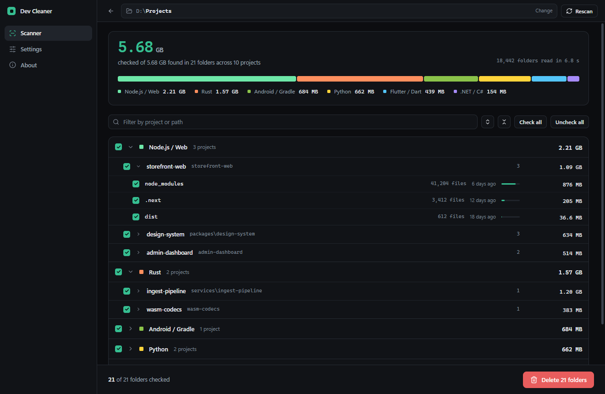
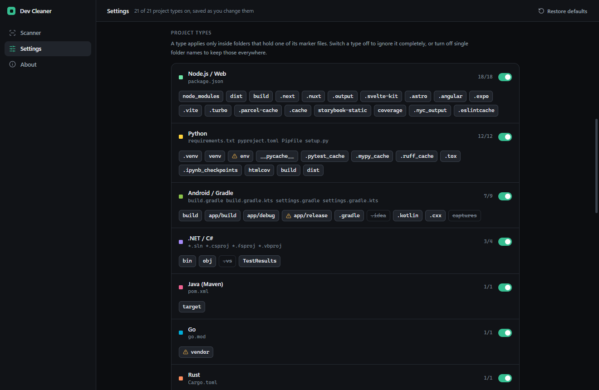

# Dev Cleaner

A desktop app that reclaims disk space by removing build output, caches and dependency folders
from your projects - without ever touching source code.

Point it at a folder, see exactly what it found and how large each item is, uncheck anything worth
keeping, then delete.



## Why it is safe

Most cleaners match folder names. Dev Cleaner does not: a folder is only ever listed when one of
its **project marker files** is present in that folder or an ancestor.

```text
photos/
└─ build/            no marker above it, never listed

work/api/
├─ Cargo.toml        marker, Rust rules apply here and below
├─ target/           listed
└─ src/              kept
```

Everything else follows from that rule:

- Deletion re-validates every path in the main process: it must sit inside the folder you scanned,
  must not be a filesystem root, and its name must appear in the built-in target list.
- Symlinks and junctions are never deleted, and are not followed while scanning unless you opt in.
- `.git`, `.hg`, `.svn` and already-flagged folders are never entered.
- Locked or permission-denied paths are reported and skipped; the rest of the run continues.
- Nothing is deleted until you check it and confirm. You can move items to the trash instead.

## Features

- **Marker-gated scanning** across 21 project types, with inheritance so nested artefacts such as
  `packages/ui/dist` or `src/pkg/__pycache__` are found inside a real project.
- **Exact sizes.** Every flagged folder is measured recursively before anything is shown; totals
  are never estimated.
- **Capacity band.** One proportional bar of the whole scan, segmented by ecosystem. Unchecking
  drains it, so you can see what each decision is worth.
- **Tree view with checkboxes** at category, project and folder level, with tri-state parents,
  per-item file counts, age and share of the project.
- **Live scan feedback** - folders read, items flagged, bytes measured, elapsed time and a
  streaming feed of what was just found. Stop at any time and keep the partial result.
- **Real deletion progress.** Deleting a large `node_modules` reports every file as it goes, with a
  determinate bar measured against the file count from the scan rather than a spinner.
- **Granular, persistent settings.** Switch off a whole project type, or single folder names inside
  it. Saved to disk and reapplied on the next launch.
- **Protected paths.** Right-click any result and choose _Never clean this folder_ or *Never clean
  this project*. Protected paths are excluded from every future scan and refused by the deleter.
- **Right-click menu** on any row: reveal in the OS file manager, copy the path, check or uncheck,
  or protect it.
- **Dark and light themes**, following the system by default.
- **Trash mode** for recoverable deletes, and a confirmation step listing the largest folders.

## Install

### From a release

Download the installer for your platform from the repository's Releases page:

| Platform | File |
| --- | --- |
| Windows (installer) | `devcleaner-<version>-setup.exe` — lets you choose the install folder |
| Windows (portable) | `devcleaner-<version>-portable.exe` — single file, unpacks to `%TEMP%` on each run |
| macOS (Apple Silicon) | `Dev Cleaner-<version>-arm64.dmg` |
| macOS (Intel) | `Dev Cleaner-<version>.dmg` |
| Linux | `Dev Cleaner-<version>.AppImage` |

Builds are **unsigned**, so the OS will warn on first launch:

- **Windows** - SmartScreen shows "unrecognised app". Choose _More info_ → _Run anyway_.
- **macOS** - Gatekeeper refuses a double-click. Right-click the app → _Open_, then confirm. Or run
  `xattr -dr com.apple.quarantine "/Applications/Dev Cleaner.app"` once.
- **Linux** - mark the AppImage executable: `chmod +x 'Dev Cleaner-<version>.AppImage'`.

### From source

```bash
git clone https://github.com/Mahmud0808/DevCleaner.git
cd DevCleaner
npm install
npm run dev
```

Requires Node.js 20 or newer.

### Nothing happens on launch

On a few Windows systems the app cannot start from inside your user profile. Install it somewhere
else, such as `D:\Programs\Dev Cleaner` - the installer lets you choose the folder. To keep it where
it is, add `--disable-gpu-sandbox` to the shortcut's target.

## Usage

1. **Choose folder** - pick the directory holding your projects (for example `~/dev`).
2. **Scan this folder** - the walker finds project markers, then measures every flagged folder.
   Press `Esc` or **Stop** to cancel; measured results are kept.
3. **Review the tree** - everything is checked by default. Uncheck whole categories, projects or
   individual folders. The figure at the top updates as you go.
4. **Delete** - confirm the summary. Failures are listed with the reason and do not stop the run.

Right-click any project or folder in the results to reveal it in your file manager, copy its path,
toggle its checkbox, or protect it from every future scan.

`Esc` cancels a running scan, and backs out of a finished one.

Targets marked with a warning triangle are safe to delete but hold state nothing regenerates
automatically: `app/release`, `Builds`, `Saved`, `captures`, `.idea`, `.vs`, `.swiftpm`,
`.pub-cache`, Go's `vendor`, Python's `env`, and Laravel's `bootstrap/cache`.

Folders holding editor or IDE state are **switched off in Settings by default**, so a scan never
looks for them at all: `.idea`, `.vs`, `.swiftpm`, Unreal's `Saved`, and Android Studio's
`captures`. Turn one on in Settings to include it.

## Supported project types

| Project type | Marker files | Folders removed |
| --- | --- | --- |
| Node.js / Web | `package.json` | `node_modules`, `dist`, `build`, `.next`, `.nuxt`, `.output`, `.svelte-kit`, `.astro`, `.angular`, `.expo`, `.vite`, `.turbo`, `.parcel-cache`, `.cache`, `storybook-static`, `coverage`, `.nyc_output`, `.eslintcache` |
| Python | `requirements.txt`, `pyproject.toml`, `Pipfile`, `setup.py` | `.venv`, `venv`, `env`, `__pycache__`, `.pytest_cache`, `.mypy_cache`, `.ruff_cache`, `.tox`, `.ipynb_checkpoints`, `htmlcov`, `build`, `dist` |
| Android / Gradle | `build.gradle(.kts)`, `settings.gradle(.kts)` | `build`, `app/build`, `app/debug`, `app/release`, `.gradle`, `.idea`, `.kotlin`, `.cxx`, `captures` |
| .NET / C# | `*.sln`, `*.csproj`, `*.fsproj`, `*.vbproj` | `bin`, `obj`, `.vs`, `TestResults` |
| Java (Maven) | `pom.xml` | `target` |
| Go | `go.mod` | `vendor` |
| Rust | `Cargo.toml` | `target` |
| C / C++ (CMake) | `CMakeLists.txt` | `build`, `cmake-build-debug`, `cmake-build-release`, `CMakeFiles` |
| PHP | `composer.json` | `vendor`, `var/cache`, `bootstrap/cache` |
| iOS / Xcode | `Podfile`, `*.xcodeproj`, `*.xcworkspace` | `Pods`, `DerivedData`, `build`, `.symlinks` |
| Flutter / Dart | `pubspec.yaml` | `.dart_tool`, `build`, `.pub-cache` |
| Ruby | `Gemfile` | `vendor/bundle`, `tmp/cache` |
| Unity | `Assembly-CSharp.csproj`, `ProjectVersion.txt` | `Library`, `Temp`, `Obj`, `Logs`, `Builds` |
| Unreal Engine | `*.uproject` | `Binaries`, `Intermediate`, `DerivedDataCache`, `Saved` |
| Swift Package | `Package.swift` | `.build`, `.swiftpm` |
| Terraform | `.terraform.lock.hcl`, `*.tf` | `.terraform` |
| Elixir | `mix.exs` | `_build`, `deps` |
| Godot | `project.godot` | `.godot`, `.import` |
| Haskell | `stack.yaml`, `*.cabal` | `.stack-work`, `dist-newstyle` |
| Zig | `build.zig` | `.zig-cache`, `zig-cache`, `zig-out` |
| OS Junk | none, applies everywhere | `.DS_Store`, `Thumbs.db`, `ehthumbs.db`, `__MACOSX` |

Every type and every folder name can be switched on or off in Settings. All of them start on except
the five editor-state folders noted above.



## Settings

| Setting | Default | Effect |
| --- | --- | --- |
| Theme | System | Follow the OS theme, or pin dark or light. |
| Move to trash | Off | Recoverable, but far slower on large folders. |
| Confirm first | On | Show the largest folders and the space freed before deleting. |
| Hidden folders | On | Required to find `.venv`, `.gradle`, `.next` and other dot folders. |
| Follow symlinks | Off | Lets a scan leave the chosen folder and risks link loops. |
| Maximum depth | 12 | Folder levels to descend below the folder you pick. |
| Never enter | empty | Extra folder names to skip, on top of the built-in list. |
| Protected paths | empty | Absolute paths never listed or deleted, including everything below them. |

Preferences are stored by `electron-store`:

- Windows - `%APPDATA%\Dev Cleaner\dev-cleaner-settings.json`
- macOS - `~/Library/Application Support/Dev Cleaner/dev-cleaner-settings.json`
- Linux - `~/.config/Dev Cleaner/dev-cleaner-settings.json`

The exact path is shown on the About screen.

## Development

```bash
npm install        # install dependencies
npm run dev        # electron-vite dev server with HMR
npm run typecheck  # tsc over main, preload and renderer
npm run build      # typecheck + production bundle into out/
npm run icons      # regenerate build/icon.png and build/icon.ico
```

### App icon

The icon is generated, not hand-drawn: [scripts/generate-icon.mjs](scripts/generate-icon.mjs)
rasterises it from the same jade and geometry the UI uses and writes `build/icon.png` (1024px) plus
a multi-size `build/icon.ico` (16 to 256px), with no image dependencies. electron-builder derives
the macOS `.icns` from the PNG at package time. Edit the constants at the top of the script and run
`npm run icons` to change it.

### Project layout

```text
src/
├─ main/            Electron main process
│  ├─ index.ts      window, theme, IPC handlers
│  ├─ scanner.ts    marker-gated walker and size measurement
│  ├─ deleter.ts    path re-validation and reporting recursive removal
│  ├─ settings.ts   electron-store persistence and migration
│  └─ fs-utils.ts   concurrency limiter, recursive sizing
├─ preload/         contextBridge API surface
├─ shared/          rule catalogue and IPC types
└─ renderer/        React UI (Tailwind, Radix)
```

### IPC surface

`get-settings`, `save-settings`, `reset-settings`, `get-settings-path`, `get-app-info`,
`select-directory`, `pick-folder`, `validate-directory`, `scan-directory`, `cancel-scan`,
`delete-items`, `reveal-path`, `copy-text`, `open-external`, plus `scan:progress`,
`delete:progress` and `theme:changed`
events. The renderer runs with `contextIsolation` on and `nodeIntegration` off, behind a strict
CSP.

### One environment gotcha

VS Code exports `ELECTRON_RUN_AS_NODE=1` into its integrated terminal. Inherited by Electron, it
boots the app as a plain Node process and `app` is undefined. `npm run dev`, `start` and `build`
therefore go through [scripts/run-electron-vite.mjs](scripts/run-electron-vite.mjs), which strips
the variable before spawning the CLI.

### Refreshing the screenshots

`src/renderer/screenshot.html` mounts the real UI against a stub `window.api` with representative
scan data, so the README images can be regenerated without a live scan. Run `npm run dev`, open
<http://localhost:5173/screenshot.html> in a browser at 1320×860, and capture the viewport.

## Releasing

### GitHub Actions

[.github/workflows/build.yml](.github/workflows/build.yml) builds all three platforms on GitHub's
own runners, so no local macOS machine is needed. GitHub hosts `windows-latest`, `macos-latest` and
`ubuntu-latest`, and each job packages only its own platform.

Two ways to run it:

- **Manual** - Actions → _Build installers_ → _Run workflow_. Installers are attached to the run as
  downloadable artifacts. Use this to test packaging.
- **Tagged** - push a version tag and the same builds are attached to a **draft** GitHub Release:

    ```bash
    npm version patch      # bumps package.json and creates the tag
    git push --follow-tags
    ```

    Review the draft under Releases, then publish it. Nothing goes public automatically.

The macOS job builds both architectures (`--x64 --arm64`), producing an Intel and an Apple Silicon
dmg. `CSC_IDENTITY_AUTO_DISCOVERY: false` stops electron-builder looking for a signing certificate
the runner does not have.

Packaging downloads a 115 MB Electron binary, so the job caches it per platform and retries
packaging up to three times to ride out a dropped download.

### Signing and notarisation, if you ever want it

Unsigned builds work; they only cost users one extra click. Removing that click is a paid step:

- **macOS** - an Apple Developer Program membership (99 USD/year). Export the *Developer ID
  Application* certificate as a `.p12`, add `CSC_LINK` (base64) and `CSC_KEY_PASSWORD` as repository
  secrets, plus `APPLE_ID`, `APPLE_APP_SPECIFIC_PASSWORD` and `APPLE_TEAM_ID` for notarisation, then
  set `mac.notarize: true` in [electron-builder.yml](electron-builder.yml).
- **Windows** - an OV or EV code-signing certificate (roughly 100–400 USD/year), supplied through
  the same `CSC_LINK` and `CSC_KEY_PASSWORD` secrets. EV certificates clear SmartScreen immediately;
  OV ones build reputation over time.

Neither is required for a public release, and neither is configured today.

### Building locally

```bash
npm run dist:win     # NSIS installer  -> release/
npm run dist:mac     # dmg             -> release/
npm run dist:linux   # AppImage        -> release/
npm run dist         # unpacked build for the current platform
```

electron-builder can only target the platform it runs on, so a local Windows machine produces the
`.exe` only. Packaging is configured in [electron-builder.yml](electron-builder.yml).

## Tech stack

Electron 33 · electron-vite · React 18 · TypeScript · Tailwind CSS · Radix UI · lucide-react ·
electron-store

## Contributing

Issues and pull requests are welcome. Please run `npm run typecheck` before opening a PR, and when
adding a project type, extend `CATEGORIES` in
[src/shared/rules.ts](src/shared/rules.ts) with the marker files that identify it and only folders
that a tool regenerates. Anything a user could not get back belongs behind a `caution` note, or not
in the list at all.

## License

[MIT](LICENSE)
